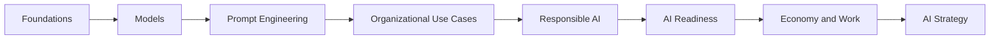

  

<h1 align="center">AI Engineering</h1>

<strong>Understanding generative AI through systems, decisions, and practice.</strong>

  <strong>English</strong> · <a href="./pt-BR/">Português do Brasil</a>

  <a href="#start-reading">Start reading</a> ·
  <a href="./SUMMARY.md">Full contents</a> ·
  <a href="./PROGRESS.md">Progress</a> ·
  <a href="./glossary.md">Glossary</a> ·
  <a href="./resources.md">Resources</a>

---

AI Engineering is an open-source book about generative AI, language models, prompting, organizational use cases, responsible AI, adoption, economic change, and strategy.

The book approaches AI from a builder's and decision-maker's perspective: understand the mechanism, identify where it fails, design the surrounding system, and connect technical choices to business outcomes.

> [!NOTE]
> This is an independent educational project inspired by the curriculum described in *IA Generativa na Era da Transformação Digital*. It is not course material from, nor affiliated with, MIT Professional Education.

## Book map

## Start reading

| Path | Start here | Focus |
| --- | --- | --- |
| Full path | [Foundations](./chapters/foundations/README.md) | Concepts, systems, adoption, and strategy |
| Technical leader | [Models](./chapters/models/README.md) | Model behavior, limits, cost, RAG, and agents |
| Team lead | [Prompt Engineering](./chapters/prompt-engineering/README.md) | Repeatable workflows and safe use |
| Executive | [Organizational Use Cases](./chapters/organization/README.md) | Value, governance, readiness, and roadmap |

## Learning by doing

Every section ends with an exercise that produces a reusable artifact: an evaluation checklist, prompt template, use-case scorecard, policy draft, readiness assessment, or AI roadmap. The final [AI Strategy](./chapters/strategy/ai-strategy.md) chapter combines them into one organizational plan.

## Source and scope

The supplied PDF defines the curriculum boundary. The manuscript expands that outline with technical explanations, practical examples, failure modes, and decision frameworks. Promotional pages, faculty biographies, and enrollment information are not part of the book's subject matter.

## License

[MIT](./LICENSE)
