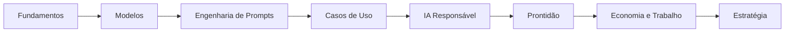

  

<h1 align="center">Engenharia de IA</h1>

<strong>Entendendo IA generativa por meio de sistemas, decisões e prática.</strong>

<a href="../">English</a> · <strong>Português do Brasil</strong>

  <a href="#comece-a-leitura">Comece a leitura</a> ·
  <a href="./SUMMARY.md">Índice completo</a> ·
  <a href="./PROGRESS.md">Progresso</a> ·
  <a href="./glossary.md">Glossário</a> ·
  <a href="./resources.md">Recursos</a>

---

Engenharia de IA é um livro técnico aberto sobre IA generativa, modelos de linguagem, engenharia de prompts, aplicações organizacionais, IA responsável, adoção, mudanças econômicas e estratégia.

A abordagem combina a perspectiva de quem constrói com a de quem decide: compreender o mecanismo, identificar onde ele falha, projetar o sistema ao redor do modelo e conectar escolhas técnicas a resultados de negócio.

> [!NOTE]
> Este é um projeto educacional independente inspirado pelo currículo descrito em *IA Generativa na Era da Transformação Digital*. Não é material do curso e não possui afiliação com o MIT Professional Education.

## Mapa do livro

## Comece a leitura

| Caminho | Comece aqui | Foco |
| --- | --- | --- |
| Completo | [Fundamentos](./chapters/foundations/README.md) | Conceitos, sistemas, adoção e estratégia |
| Liderança técnica | [Modelos](./chapters/models/README.md) | Comportamento, limites, custo, RAG e agentes |
| Liderança de equipes | [Engenharia de Prompts](./chapters/prompt-engineering/README.md) | Fluxos repetíveis e uso seguro |
| Executivos | [IA na Organização](./chapters/organization/README.md) | Valor, governança, prontidão e roadmap |

## Aprender fazendo

Cada seção termina com uma atividade que produz um artefato reutilizável. Ao final, esses artefatos formam uma estratégia organizacional de IA com prioridades, responsáveis, riscos, dependências e métricas.

## Licença

[MIT](../LICENSE)
